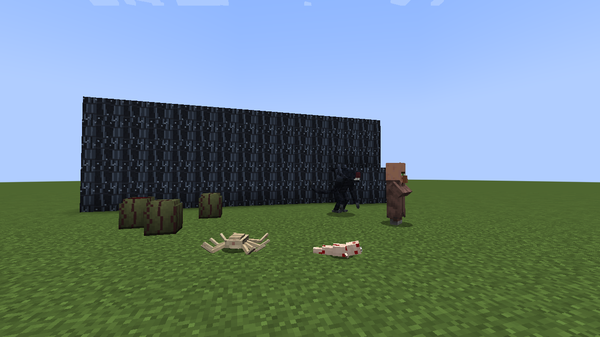

# Hive Invasion – Fabric-Mod für Minecraft 1.21.1

Eine außerirdische Brut überfällt die Welt. Eigene Kreaturen mit Parasiten-Lebenszyklus,
Säureblut, Nestern – und später Städte, Militär, Fahrzeuge und Cutscenes.



Clips: [Anzug anlegen](docs/media/clip-anzug-anlegen-v0.2.mp4) · [Kampf im Exo-Anzug](docs/media/clip-kampf-v0.2.mp4)

## Neu in Version 0.2

| Inhalt | Was es tut |
|---|---|
| **Blut** | Rote Blutspritzer und Blutlachen bei Menschen und Tieren, leuchtend grünes Säureblut bei Aliens (Säurelachen ätzen). Lachen trocknen nach einigen Minuten weg. |
| **Leichen** | Spieler und fast alle Mobs bleiben nach dem Tod liegen (auf der Seite, mit Skin). Sie haben Schwerkraft, lassen sich schieben und wegschlagen. **Rechtsklick** öffnet die Beute des Toten, **Schleichen + Schlagen** räumt die Leiche weg. |
| **Exo-Anzug** | Aufstellen, mit dem Rücken davorstellen, **Exo-Auslöser** benutzen (oder den roten Knopf am Anzug drücken): Der Anzug schließt sich mit Kamerafahrt um dich – Beine, Brust, Arme, Helm. 1,5-fache Größe, 150 Panzerung. **Linksklick** Plasmakanone, **Rechtsklick halten** Energieschild, **Leertaste halten** Sprungdüsen, **Schleichen** aussteigen. Reparatur mit Eisenbarren. |
| **Grafik** | Alle Aliens mit neuen, detaillierten Modellen und Texturen (Modell-/Textur-Generator `tools/modelgen.py`). |

**Rezepte:** Exo-Anzug = 4 Eisenblöcke, Diamant, 2 Redstone-Blöcke, Netheritplatte. Auslöser = Redstone über Eisenbarren.

## Version 0.1 (Phase 1)

| Inhalt | Was es tut |
|---|---|
| **Brutkapsel** (Block) | Öffnet sich, wenn ein Spieler oder Dorfbewohner näher als 4 Blöcke kommt, und entlässt einen Klammerer. Offene Kapseln wachsen langsam wieder zu. |
| **Klammerer** | Springt Spieler, Dorfbewohner und Tiere an, klammert sich ans Gesicht (Blindheit, Übelkeit, Langsamkeit) und pflanzt eine Larve ein. |
| **Parasit** (Effekt) | 2 Minuten Brutzeit. In den letzten 30 Sekunden Übelkeit und Hunger – dann bricht die Larve heraus (18 Schaden, ignoriert Rüstung). |
| **Larve** | Flieht vor Spielern und wird nach 3 Minuten zum Stalker. |
| **Stalker** | Erwachsenes Alien: 40 Leben, 7,5 Schaden, klettert Wände hoch, jagt Spieler, Dorfbewohner und Eisengolems. Spawnt selten nachts/in Höhlen. |
| **Säureblut** | Wer ein Alien im Nahkampf trifft, dessen Waffe nimmt Extra-Schaden, manchmal gibt es Säure ab. |
| **Nest-Harz** (Block) | Baumaterial für Nester. |

**Balance:** Alle Alien-Werte hängen an `HiveInvasion.ALIEN_STRENGTH = 1.25` – Aliens sind
25 % stärker als ein vergleichbarer Mensch/Soldat (Basis: 32 Leben, 6 Schaden).

**Bekannt:** Milch entfernt den Parasiten-Effekt noch (wird später verhindert).

## Fahrplan

1. **Phase 1 – Die Brut** ✅ Kapsel, Klammerer, Larve, Stalker, Säureblut
2. **Phase 2 – Nester:** riesige generierte Nester in Höhlen und unter der Erde, mit Harzwänden,
   Brutkammern und **eingesponnenen Opfern** (tote Spieler/Dorfbewohner in den Wänden), Königin als Boss
3. **Phase 3 – Städte & Zivilisten:** generierte Städte mit Zivilisten, die fliehen, sich verstecken
   und von Aliens verschleppt werden; Alien-Angriffe auf Städte als Ereignis
4. **Phase 4 – Militär:** Soldaten-NPCs mit Waffen, Basen, Ränge – der Spieler kann beitreten
   und Aufträge annehmen
5. **Phase 5 – Fahrzeuge:** Truppentransporter (KI fährt dich zum Einsatz), Jeeps, Hubschrauber –
   selbst steuerbar oder von KI-Piloten geflogen
6. **Phase 6 – Cutscenes:** Kamerafahrten bei Nest-Entdeckung, Königin-Kampf, Stadtangriff

## Bauen

```bash
./gradlew build          # Mod-Datei landet in build/libs/hive-invasion-<version>.jar
./gradlew runClient      # Spiel mit der Mod starten (zum Testen)
```

Benötigt Java 21. In den `mods`-Ordner gehört zusätzlich die **Fabric API**.
